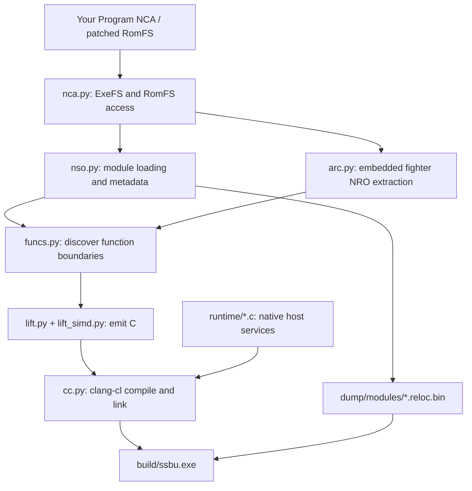
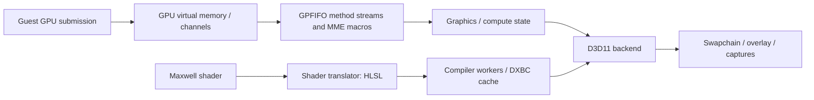

# How NativeSmash works

[← README](../README.md) · [Setup guide](BUILDING.md) · [Multiplayer](MULTIPLAYER.md) · [DLC and unlocks](DLC-AND-UNLOCKS.md) · [Several versions](VERSIONS.md)

NativeSmash is a static recompiler plus a Windows compatibility runtime, specialized for this game. CPU code is translated before launch. GPU programs are translated when encountered. Selected operating-system and SDK entry points are implemented natively, while the remaining game and SDK code executes as compiled guest functions.

This document describes the checked-in implementation. Implemented paths and developer test tools should not be read as a compatibility guarantee for every mode, fighter, stage, or machine.

## Contents

| Section | Covers |
| :--- | :--- |
| [1. From extracted modules to a Windows executable](#1-from-extracted-modules-to-a-windows-executable) | Inputs, function discovery, translation, module placement. |
| [2. Loading, symbols, and guest execution](#2-loading-symbols-and-guest-execution) | Mapping, binding, native replacements, exceptions. |
| [3. Native services](#3-native-services) | The runtime's service implementations, files and fonts. |
| [4. The graphics path](#4-the-graphics-path) | GPU commands, the D3D11 back end, shader compilation, audio and video. |
| [5. Multiplayer transport](#5-multiplayer-transport) | The relay, the lobby and direct connections. |
| [6. DLC and fighter unlocks](#6-dlc-and-fighter-unlocks) | Installed-content reporting and save editing. |
| [7. Tool reference](#7-tool-reference) | Every tool in `tools/`. |
| [Verification and debugging](#verification-and-debugging) | Tests, the overlay, reports and diagnostic switches. |
| [Build boundaries](#build-boundaries) | What is source, and what stays local. |

## 1. From extracted modules to a Windows executable



### Inputs and discovery

[`nca.py`](../tools/nca.py) reads package headers, ExeFS containers, and RomFS tables using keys supplied locally. [`nso.py`](../tools/nso.py) handles module decompression and dynamic metadata, including imports, exports, relocations, and information useful for ELF conversion.

[`funcs.py`](../tools/funcs.py) finds function entries from exception-frame tables, exported function symbols, relocations into executable memory, initialization arrays, direct call targets, and recognizable import stubs. These sources provide more structure than a linear disassembly alone. Exception metadata also supplies extents used by the recompiler.

Fighter modules live inside `data.arc`. [`arc.py`](../tools/arc.py) resolves hashed archive paths and reads the compressed filesystem metadata. Its `nro` command extracts known modules from `prebuilt:/nro/release/`. The known-name list is version-specific; a name being listed does not mean its bytes exist in a particular archive.

### Translation

[`recomp.py`](../tools/recomp.py) orchestrates image preparation, C emission, incremental compilation, and linking. Each guest function becomes a C function accepting a `Cpu *` context. [`lift.py`](../tools/lift.py) emits integer/control-flow operations; [`lift_simd.py`](../tools/lift_simd.py) handles AdvSIMD/NEON operations with explicit vector lanes.

[`runtime/recomp.h`](../runtime/recomp.h) defines the shared contract:

- 31 general registers, the guest stack pointer, 32 vector registers, FP control/status, and thread-local register state.
- Guest memory operations expressed as host accesses to the mapped guest addresses.
- Function lookup for guest code pointers and cached indirect branch targets.
- Helpers for atomics, arithmetic, floating-point behavior, traps, and exception transitions.

Direct branches can target generated C labels/functions. Indirect calls resolve guest code addresses to native function pointers. Tail-call helpers keep supported guest tail transfers from accumulating unnecessary host stack frames. Unsupported instructions or unavailable targets can produce a trap; they do not establish complete instruction coverage.

The build disables floating-point contraction and fast-math-style assumptions to preserve guest arithmetic behavior. `clang-cl` produces x64 object files, then links them with the native runtime and Windows libraries.

### Stable module placement

The primary modules have explicit guest bases in `recomp.py`: `main`, `subsdk0`, and `sdk`. Extracted NRO modules receive aligned address ranges, recorded locally in `dump/nro/bases.txt`. The generated registry binds build IDs to the matching compiled module.

That address manifest is a build input. Preserve it when incrementally rebuilding an existing installation; generated code and relocation images must agree on placement.

With several game versions in one checkout ([several versions](VERSIONS.md)), `module_bases.txt` at the checkout root keeps one address per build ID across all version folders. A module that is byte-identical between versions then gets the same address everywhere, and [`modcache.py`](../tools/modcache.py) reuses its generated C and objects from another version's build instead of building it again.

## 2. Loading, symbols, and guest execution

[`host.c`](../runtime/host.c) maps `*.reloc.bin` images at their expected guest addresses, registers module ranges, publishes exports, resolves imports, and applies symbol relocations. Function metadata associates guest addresses with compiled host functions.

Native replacements use `HLE(symbol)` declarations. The build detects those names and redirects applicable guest entry points to runtime implementations. Unresolved strong imports receive diagnostic handlers rather than silently acquiring arbitrary implementations.

Startup enters the guest SDK initialization path and eventually `nnMain`. Guest execution runs on a Windows thread with a large reserved stack. Modules loaded later through `nn::ro` are matched by build ID, mapped, bound, and initialized when requested.

[`hle_ro.c`](../runtime/hle_ro.c) can save an unrecognized module image into the local NRO dump directory. Harvesting a module does not compile it: a later rebuild must translate and link it. The runtime's missing-module behavior is a development aid, not a substitute for preparing the full module set.

### Exceptions and non-local control flow

The guest's own unwind implementation interprets guest exception metadata. [`hle_unwind.c`](../runtime/hle_unwind.c) bridges its final register/context transfer to the corresponding recompiled host frame using a structured host exception and landing-pad filters. [`hle_setjmp.c`](../runtime/hle_setjmp.c) and [`hle_fiber.c`](../runtime/hle_fiber.c) implement related control-flow bridges.

## 3. Native services

| Source | Responsibility |
| :--- | :--- |
| [`kernel.c`](../runtime/kernel.c) | Guest thread contexts, synchronization, handle/state tracking, memory operations, and supported supervisor calls. |
| [`clock.h`](../runtime/clock.h) | The one clock behind the guest's system tick, the kernel's timeouts, and the renderer's timing: Windows' `QueryPerformanceCounter`, or, where a read of it is slow (a PC timed by the HPET), the CPU's invariant time stamp counter scaled to the same nanoseconds. `SSBU_CLOCK=qpc` or `tsc` picks one; `build\play.log`'s `[clock]` line says which. |
| [`ipc.c`](../runtime/ipc.c), `ipc_*.c` | Service request handling and selected audio, display, Mii, and related interfaces. |
| [`hle_fs.c`](../runtime/hle_fs.c) | RomFS reads, save/cache mounts, and host file operations. |
| [`hle_env.c`](../runtime/hle_env.c), [`hle_applet.c`](../runtime/hle_applet.c) | Account/environment behavior, applet-facing functions, and installed add-on reporting. |
| [`hle_hid.c`](../runtime/hle_hid.c), [`hle_pad.c`](../runtime/hle_pad.c) | Up to eight players' pads, keyboard input, rumble, and optional scripted input. An input thread owns SDL3 (loaded from `SDL3.dll` at run time; XInput pads 1-4 without it) and copies each pad's state for the game's threads; `controllers.ini` maps pads to players and buttons. GameCube controllers (Nintendo's adapter, through SDL3's own driver) report the console's GameCube style, with analog triggers and an on/off motor, so the game uses its GameCube controls. |
| [`hle_pl.c`](../runtime/hle_pl.c) | Shared-font loading from locally supplied `.bfttf` files. |
| [`hle_nv.c`](../runtime/hle_nv.c) | Supported GPU-driver interfaces, address mapping, and channel operations. |
| [`hle_net.c`](../runtime/hle_net.c), [`net_relay.c`](../runtime/net_relay.c) | Virtual networking, Local Wireless, socket behavior, relay transport, and optional UPnP. |
| [`hle_online.c`](../runtime/hle_online.c) | The game's Online mode: NEX and Pia sent to the online lobby's game server, NEX's TCP streams carried to the lobby, and the SHA-1 its WebSocket needs. |
| [`hle_offline.c`](../runtime/hle_offline.c) | Selected offline service behavior needed by the target game. |

These are targeted service implementations, not a complete implementation of the console OS. Some functions return fixed or limited behavior appropriate to the supported paths.

### Files and fonts

`dump/modules/romfs.cfg` contains two lines: a host file path, then the byte offset at which an unencrypted RomFS begins. Relative paths resolve against the game's working directory. The runtime reads RomFS metadata and game files in place rather than extracting all assets.

Save data and cache files are host directories. `SSBU_DATA_ROOT` can redirect those per-run files for testing. A network identity is separate from save contents: copying `netplay_id.txt` to another PC can make two installs appear as the same player.

The font service loads six firmware font files, decodes their container format, and maps shared font memory. Fonts are user-supplied runtime inputs, not repository assets.

## 4. The graphics path



[`gpu.c`](../runtime/gpu.c) parses Tegra/Maxwell command streams, engine bindings, method writes, macros, transfers, synchronization, and dispatch/draw events. [`gpu_host1x.c`](../runtime/gpu_host1x.c) covers the Host1x/video-related job path. The backend interface separates command/state handling from rendering.

As on the console, the GPU runs alongside the CPU. A submission is copied into a queue and the driver gets its fence back at once; a GPU thread of its own ([`gpu_queue.c`](../runtime/gpu_queue.c)) runs the queue in order, and a submission's sync point reaches its fence when it has run, which is what the driver's fence waits wait for. A buffer queued for display is shown once everything submitted before it has run, and unmapping GPU addresses or decommitting memory that holds GPU allocations waits for the queue first. Rendering inside the submitting call instead put all of it on the game's main thread (in an 8-player match about 60% of that thread); `SSBU_GPU_THREAD=0` still does that, for comparison.

[`gpu_d3d11.c`](../runtime/gpu_d3d11.c) creates D3D resources, tracks render targets and pipeline state, uploads or retains guest buffers, handles graphics/compute work, and presents the result. [`gpu_display.c`](../runtime/gpu_display.c) owns the window (windowed, borderless, or full screen, from `display.ini`) and the pacing of presents: a 60 Hz high-resolution clock, the same clock presenting with tearing allowed for variable-refresh monitors, or the monitor's own refreshes. The game's 1920 x 1080 picture is drawn first, then scaled to the window at 16:9. With `display.ini`'s `render_scale`, every render target is created that many times the game's size: the game still works in its own pixels, and the renderer scales what is given in pixels (viewports, scissors, 2D-engine blits) to each target's size. Shaders sample with normalized coordinates, so almost none need to change; the few that read their pixel's position or step in texels (texel offsets, texel fetches) get the scale through spare words of the per-draw constants, and those few cache their compiled code under a salted hash so files from before scaling are not used for them. A picture bigger than the window is averaged down to it in linear light. [`gpu_texture.c`](../runtime/gpu_texture.c) contains texture-format/layout helpers. [`gpu_shader.c`](../runtime/gpu_shader.c) decodes guest shader instructions and emits HLSL.

### Shader compilation and the driver fix

CPU code is compiled ahead of time; GPU shaders remain demand-driven. A new shader is translated to HLSL, then queued for compilation. Persisted DXBC cache loads have priority over new HLSL compiles.

The current implementation uses up to 16 dedicated compiler workers with 64 MiB reserved stacks. The `SSBU_COMPILE_THREADS` environment variable controls the worker count within the implementation's limits. Shader cache entries include a translation-version marker and relevant shader/state hashes.

The shader fix addresses driver compilation on small internal worker stacks. A second D3D11 device, created with internal threading optimizations disabled, warms driver compilation on NativeSmash's own compiler threads. The rendering device retains its normal threading behavior. Compilation stages and current jobs are retained for crash reporting.

At start, the compiler threads create every cached DXBC program of the current cache version that the game has used, on both devices, on a queue below the game's own loads and compiles (`SSBU_SHADER_PREWARM=0` turns this off). When the game first uses such a program, it is still translated for its interface, but the prepared object is taken instead of a new compile, so its draws are not skipped. [`gpu_shader_cache.h`](../runtime/gpu_shader_cache.h) holds what the renderer and the ahead-of-time compiler must agree on: the cache version, the program hash, the file name, and the compiler flags. [`shader_aot.py`](../tools/shader_aot.py) finds the game's programs in `data.arc` and compiles them into the cache in advance; its files stay dated 2001 until the game first uses them, and the start-up preparation leaves them out until then.

AMD's Direct3D 11 driver compiles a program to GPU code at the first draw that uses it, not when the program is created, so creating the cached programs at start did not spare the game that compile: it happened in the match, the first time a move or its effect showed, every session. With AMD's driver (`SSBU_SHADER_WARM=0` turns this off, `=1` on with any driver), each program the start-up preparation makes is also drawn once, into a 1x1 target with a partner shader matching its interface, taking at most a quarter of the renderer's time; where the driver's own disk cache has the program that is about a millisecond. If the first three such draws in a row each take over 20 ms (the driver compiling), the start-up draws stop and the game's own draws compile the rest as before. When the game closes, it starts `ssbu --warm-shaders` in the background, which draws every program the game has used once, on Direct3D devices of its own, so that the driver's disk cache has them for the next start; its result is written to `warm.log` in the shader cache, and the next start shows it in the log. Every session's log also has a `[status] first draws with a shader` line: how many draws first used a shader, and how many of those took the renderer over 4 ms.

This is a targeted mitigation, not a claim of driver-independent behavior. Rendering work with unavailable shaders can be skipped while compilation is pending. First-use hitches, incomplete visuals, or translation failures still need investigation on each supported path.

### Audio and video

`ipc_audio.c` supplies the audio-service path; `ipc_opus.c` uses a statically linked libopus. The video path reconstructs VP9 frame information and decodes with libvpx. [`gpu_vp9.c`](../runtime/gpu_vp9.c) contains frame/header logic; its default probability tables carry [libvpx attribution](../NOTICE.md).

Both codecs are built from the sources in [`third_party/`](../third_party/README.md) by [`codec_libs.py`](../tools/codec_libs.py) when the program is linked (`cc.py` adds `SSBU_HAVE_OPUS` and `SSBU_HAVE_VPX`); a developer's own builds take their place through `SSBU_OPUS_LIBS` and `SSBU_VPX_DIR`. Without either, the game builds and runs with that codec silent.

## 5. Multiplayer transport

The game continues to run its own Local Wireless session logic. NativeSmash presents a virtual LAN and carries UDP payloads through a relay. This does not replace the game's netcode with rollback networking.

[`net_relay.c`](../runtime/net_relay.c) implements both the game-side client and the integrated host relay of a private room. [`ssbu_relay.py`](../tools/ssbu_relay.py) is the online lobby: the same transport, plus room lists. The default UDP port is `39420`, and virtual addresses are allocated within `10.13.0.0/16`.

The protocol (version 2) uses a short magic/version/type header, big-endian fields, join/welcome/member messages, keepalive ping/pong, forwarded data, leave messages, and the lobby's list/listing/list-end messages. A join carries the main module's build id, so players of different game versions never meet. A private relay's rooms hold at most eight members; the game's selected mode can impose a smaller player limit. Peers silent for ten seconds are removed.

The lobby gives every player an address of its own and partitions players by build id and lobby code (`SSBU_NET_ROOM`; `smash`, the default, is the public lobby). `nn::ldn`'s scan asks the lobby for its room list and waits up to 500 ms for it. Room membership is derived from the Local Wireless messages the lobby relays, and a room's traffic passes only between that room's players. The client accepts join answers only from the host it asked, and adverts, departures and kicks only from the network's host. A lobby that has not answered for five seconds counts as offline: Local Wireless then reports itself unavailable, as without netplay.

Direct connections keep protocol version 2 and are negotiated: a lobby that introduces players sets a flag in its welcome, and a game that can connect directly sends a longer ping; older games and lobbies ignore both. The lobby sends each player a peer list of its room (type 12). A pair is introduced only when both allow it and their games have already exchanged game packets through the lobby; it then gets each other's public address as the lobby sees it (plus the LAN address when both share a public IP) and a 64-bit secret. Punch hellos and acks (type 14) carry nonces, and a path counts only once an ack echoes a recent hello from the address it went to. Game packets then travel as type 15 with the pair's secret, and the receiving game delivers one only from a lobby-given address, with the sender's own virtual address, on a game port, from a node of its Local Wireless network. Broadcasts go to the lobby as type 13, which forwards them to the room's players the sender does not reach directly. Local Wireless's own control messages always go through the lobby. A pair falls back to the lobby when punching gets no answer within 5 s, or when a direct path has had no ack for 1.2 s; hellos continue so a path can recover. `SSBU_NET_DIRECT=0` (or `off` in `online_direct.txt`) opts out, and the lobby then shares that player's address with nobody.

The game's Online mode logs in to a NEX game server of NativeSmash's own, [`tools/nex`](../tools/nex/) (standard-library Python), which [`ssbu_online_lobby.py`](../tools/ssbu_online_lobby.py) runs inside the lobby at the lobby's virtual address, `10.13.0.1`. With netplay configured, [`hle_env.c`](../runtime/hle_env.c) gives the user a network service account: an id derived from `netplay_id.txt`, and an id token with that id and the player name, which only this server reads. Hooks in [`hle_online.c`](../runtime/hle_online.c) give NEX a direct server address, with which it opens its WebSocket without TLS, and resolve Nintendo's server names (the game server, Pia's NAT check servers) to the lobby; nothing goes to Nintendo. NEX's stream socket travels over a TCP connection to the lobby's port, and the game server answers login, matchmaking (MatchmakeExtension, MatchMaking, NAT traversal), ranked ratings and the Online menu's other calls. Matched players' Pia traffic then crosses the virtual LAN as Local Wireless's does, relayed by the lobby only between players the game server put in one match. The server lets a connection act only for the player it logged in as and on gatherings that player belongs to, and bounds connections, buffers and stored state. `python -m nex.selftest`, run in `tools`, tests it without a game.

Lobby codes and room names are routing identifiers, not passwords. The protocol is not encrypted or an authenticated public service. Use it with trusted players and a reachable relay. A virtual LAN can simplify connectivity when the host cannot accept inbound UDP directly. Follow the [multiplayer setup guide](MULTIPLAYER.md).

## 6. DLC and fighter unlocks

The target game's content archive already contains assets and code for the DLC available in that version. `aoc.cfg` reports locally installed add-on indices to `nn::aoc`; it does not add newer game data. DLC fighter NROs must also be extracted and compiled.

The unlock tools edit the known save layout of 11.0.0, which 13.0.5 shares; they identify a version folder by its program's build ID, validate the fighter tables, and create a backup. Base-game selection flags and associated milestones are separate from installed DLC reporting. Mii Fighters may still need to be created in-game. See the [DLC and unlocks guide](DLC-AND-UNLOCKS.md) for usage and limitations.

## 7. Tool reference

Paths below are relative to the repository root. `tools/` holds what the installer, the build and the launchers run; `tools/dev/` holds the developers' analysis, verification and automation tools, which may require `tests/requirements-dev.txt` and locally prepared game inputs; `tools/linux/` is the Linux build ([Linux](LINUX.md)). Several modules are libraries imported by the driver rather than general user commands.

### Build and content preparation (`tools/`)

| Tool | Role |
| :--- | :--- |
| [`nca.py`](../tools/nca.py) | Inspect packages; extract ExeFS/RomFS files; generate `romfs.cfg` and installed-content `aoc.cfg`. |
| [`arc.py`](../tools/arc.py) | Inspect `data.arc`, extract named paths, and collect known embedded NRO modules. Uses Python 3.14's `compression.zstd`, or the `zstandard` package on older Pythons. |
| [`gamefiles.py`](../tools/gamefiles.py) | Say what a folder of game files holds (the guide's folder or an emulator's installed-content folder): the program to build from, base or update, DLC, versions. |
| [`build_game.py`](../tools/build_game.py) | The one-command build behind `launchers\Build NativeSmash.bat`: tools check, packages, program, fonts, data (decrypting or applying an update when needed), DLC, fighters, build. |
| [`codec_libs.py`](../tools/codec_libs.py) | Build libopus and libvpx's VP9 decoder from `third_party/` into static libraries, when they are missing or stale ([third-party sources](../third_party/README.md)). |
| [`install_windowsmash.ps1`](../tools/install_windowsmash.ps1) | What `Install NativeSmash.bat` runs: PC checks, Python, the compiler, SDL3, the folder wizard, then `build_game.py`. |
| [`update.py`](../tools/update.py) | Apply an update package as a layered RomFS in a version folder, checking every block against the update's hashes ([later versions](UPDATES.md)). |
| [`install_version.py`](../tools/install_version.py) | Install and build a game version in a folder of its own with one command ([several versions](VERSIONS.md)). |
| [`modcache.py`](../tools/modcache.py) | Share module addresses and reuse module builds across version folders by build ID. |
| [`nso.py`](../tools/nso.py) | Read NSO/NRO images and dynamic metadata; inspect modules and export ELF representations. |
| [`funcs.py`](../tools/funcs.py) | Discover functions and optionally write a function inventory. |
| [`recomp.py`](../tools/recomp.py) | Run `coverage`, `emit`, `image`, `build`, `compile`, `link`, the end-to-end `all` driver, the `check` of unresolved imports, or `wrap-sig` for a hook's code signature. |
| [`lift.py`](../tools/lift.py) | AArch64 integer/control-flow lifting implementation. |
| [`lift_simd.py`](../tools/lift_simd.py) | NEON/AdvSIMD lifting implementation. |
| [`a64.py`](../tools/a64.py) | Shared instruction-emission helpers, register expressions, types, and unsupported-operation handling. |
| [`cc.py`](../tools/cc.py) | Find `clang-cl`, construct compile options, compile incrementally, and link Windows executables. |

### Analysis and diagnostics (`tools/dev/`)

| Tool | Role |
| :--- | :--- |
| [`disasm.py`](../tools/dev/disasm.py) | Disassemble an address range, optionally beside lifted C output. |
| [`calls.py`](../tools/dev/calls.py) | List a function's direct calls and name imported callees. |
| [`census.py`](../tools/dev/census.py) | Summarize imported/exported SDK boundaries and dynamically requested NVN entry points. |
| [`insn_census.py`](../tools/dev/insn_census.py) | Count decoded instruction forms in a module's text. |
| [`ipc_reach.py`](../tools/dev/ipc_reach.py) | Trace direct-call reachability to service IPC boundaries; indirect calls make its result a lower bound. |
| [`eh.py`](../tools/eh.py) | Inspect exception-frame information and C++ landing-pad tables. |
| [`find_crc.py`](../tools/dev/find_crc.py) | Find the CRC-32 table and code references to it. |
| [`strrefs.py`](../tools/dev/strrefs.py) | Report strings referenced by instructions in a range. |
| [`sym.py`](../tools/dev/sym.py) | Resolve module-relative offsets to nearby exported function symbols. |
| [`hostsym.py`](../tools/dev/hostsym.py) | Resolve host executable offsets using a locally generated linker map. |
| [`sass.py`](../tools/dev/sass.py) | List or count Maxwell shader instructions in dumped shader binaries. |
| [`hlslc.py`](../tools/dev/hlslc.py) | Compile an HLSL file through Windows D3DCompiler and report diagnostics. |
| [`shot.py`](../tools/dev/shot.py) | Convert captured BMP frames to PNG and summarize colors. |

### Verification and automation (`tools/dev/`)

| Tool | Role |
| :--- | :--- |
| [`difftest.py`](../tools/dev/difftest.py) | Compare lifted single-instruction behavior against Unicorn across sampled CPU states. |
| [`functest.py`](../tools/dev/functest.py) | Compare selected whole leaf functions against Unicorn, including registers and memory writes. |
| [`shadertest.c`](../tools/dev/shadertest.c) | Translate dumped guest shaders and compile their HLSL with D3DCompiler. |
| [`padtest.c`](../tools/dev/padtest.c) | Check the controller layer offline: configuration, button mapping, GameCube controllers, sticks, player slots, and rumble pacing. |
| [`clocktest.c`](../tools/dev/clocktest.c) | Check the clock offline: the timer it picks (also with a system timer slowed to a microsecond a read), that it never goes back across threads, and its rate and cost (`tests/test_clock.py` builds and runs it). |
| [`vp9test.c`](../tools/dev/vp9test.c) | Replay recorded NVDEC jobs through the VP9 path and libvpx. |
| [`vp9rt.c`](../tools/dev/vp9rt.c) | Exercise VP9 header reconstruction with an independently parsed synthetic clip. |
| [`menurun.sh`](../tools/dev/menurun.sh) | Script menu navigation, captures, and logging using a copied test save. |
| [`autobattle.sh`](../tools/dev/autobattle.sh) | Drive a timed menu-to-battle input sequence for local diagnostics. |
| [`netpair.sh`](../tools/dev/netpair.sh) | Run two local instances through loopback relay transport with separate copied test data. |
| [`smoke.ps1`](../tools/dev/smoke.ps1) | Compile and execute a small known game-function smoke harness against prepared local inputs. |

### Play, package and serve (`tools/`)

| Tool | Role |
| :--- | :--- |
| [`shader_aot.py`](../tools/shader_aot.py), [`shaderaot.c`](../tools/shaderaot.c) | Find the game's shader programs in `data.arc` and compile them ahead of time into a version's disk cache, as the renderer would (`launchers\Prepare Shaders.bat`). |
| [`ssbu_relay.py`](../tools/ssbu_relay.py) | Run a standalone UDP relay without the game, native runtime, or game files. |
| [`ssbu_online_lobby.py`](../tools/ssbu_online_lobby.py), [`nex/`](../tools/nex/) | Run the online lobby with the game server for Online mode (UDP and TCP on one port); `python -m nex.selftest` tests the server. |
| [`bundle_ssbu.py`](../tools/bundle_ssbu.py) | Stream a local build into a portable ZIP64, rewrite the RomFS location, and verify CRC/SHA-256. |
| [`unlock_all.py`](../tools/unlock_all.py) | Validate, back up, and unlock the compatible local save using Python. |
| [`Unlock-All-Fighters.ps1`](../tools/Unlock-All-Fighters.ps1) | Equivalent Windows save-unlock helper, with a running-game guard and atomic backup/replacement. |
| [`Configure-Game-Data.ps1`](../tools/Configure-Game-Data.ps1) | Configure a runtime release using a separately supplied RomFS, fonts, and optional installed-content config. |
| [`pick_version.bat`](../tools/pick_version.bat) | Let the launchers list the built game versions and ask which to start. |

The `.sh` helpers expect a Unix-like shell/tool environment that can run the Windows executable. They recreate their named output/test directories; use disposable capture paths. They are developer scripts, not required player launchers.

## Verification and debugging

Source-only checks:

```powershell
python -m unittest discover -s tests -v
```

Game-backed checks after preparing local modules:

```powershell
python tools/recomp.py coverage dump/exefs/main --jobs 8
python tools/dev/difftest.py dump/exefs/main --jobs 8
python tools/dev/functest.py dump/exefs/main --jobs 8
```

Differential results apply to the sampled encodings, states, and functions. Whole-function tests deliberately skip reference runs that cannot complete in isolation; neither test is proof that every game path works.

The overlay exposes frame/rendering counters. F1 toggles the overlay, F2 shows details (with the connected pads), F3 captures a frame, F4 requests draw diagnostics, F6 triggers a sampling profile, and F11 switches to full screen.

A host exception writes `reports/crash_<time>.txt` with a minidump, and a runtime stop writes `reports/stopped_<time>.txt`. The minidump is written by a second process (the same executable started with `--write-dump`), because a process that dumps itself can deadlock on a lock held by one of its suspended threads. A watchdog ([`debug_watchdog.c`](../runtime/debug_watchdog.c)) writes `reports/freeze_<time>.txt` and a minidump when no frame has been presented for 5 s (again at 30 s and 120 s): the owners of the renderer's, present queue's, kernel's, and GPU channel's locks, the shader compiles in flight, the guest threads' states, and every thread's stack, with guest functions named by module offset. `SSBU_WATCHDOG=0` turns the watchdog off; `SSBU_MINIDUMP=0` writes no minidumps and `SSBU_MINIDUMP=full` writes all memory. `SSBU_HITCH=<ms>` logs every frame longer than that with what the main, vsync, and renderer threads spent it on: the program's functions by name once its map has been read (a few seconds after start), and for a wait inside a driver or library, the program's function that called into it (`... via <function>`). Locally generated linker maps are useful to `hostsym.py` and profiling tools, but are not required to run a release build.

Useful environment variables include `SSBU_DATA_ROOT`, `SSBU_SHADER_CACHE`, `SSBU_SHADER_PREWARM`, `SSBU_SHADER_WARM`, `SSBU_COMPILE_THREADS`, `SSBU_DUMP_SHADERS`, `SSBU_DUMP_HLSL`, `SSBU_INPUT`, `SSBU_CAPTURE`, `SSBU_CONTROLLERS` (another `controllers.ini`), `SSBU_PAD_BACKEND=xinput`, `SSBU_DISPLAY` (another `display.ini`), `SSBU_WINDOW`, `SSBU_WINDOW_SIZE`, `SSBU_PACING`, `SSBU_RENDER_SCALE` (`display.ini`'s `render_scale`), `SSBU_SCALE_SKIP` (render target sizes kept at 1x, e.g. `square,960x540`, to find which one a scaling artifact comes from), `SSBU_GPU` (`display.ini`'s `gpu`; `warp` for Windows' software renderer), `SSBU_D3D_DEBUG` (Direct3D's debug layer, its messages in the log; needs Windows' optional *Graphics Tools*), `SSBU_WATCHDOG`, `SSBU_MINIDUMP`, `SSBU_HITCH`, `SSBU_CLOCK`, and the [network variables](MULTIPLAYER.md#reference-environment-variables). Several other `SSBU_*` switches are implementation-level debugging controls; consult their use sites before enabling them.

## Build boundaries

Checked-in code defines the recompiler and native runtime. Local game inputs supply the guest program and assets. A runtime release contains the compiled executable/module images but still requires separately supplied game data and fonts. Generated C, binaries, caches, captures, local bundles, and personal data stay out of the Git source tree.
